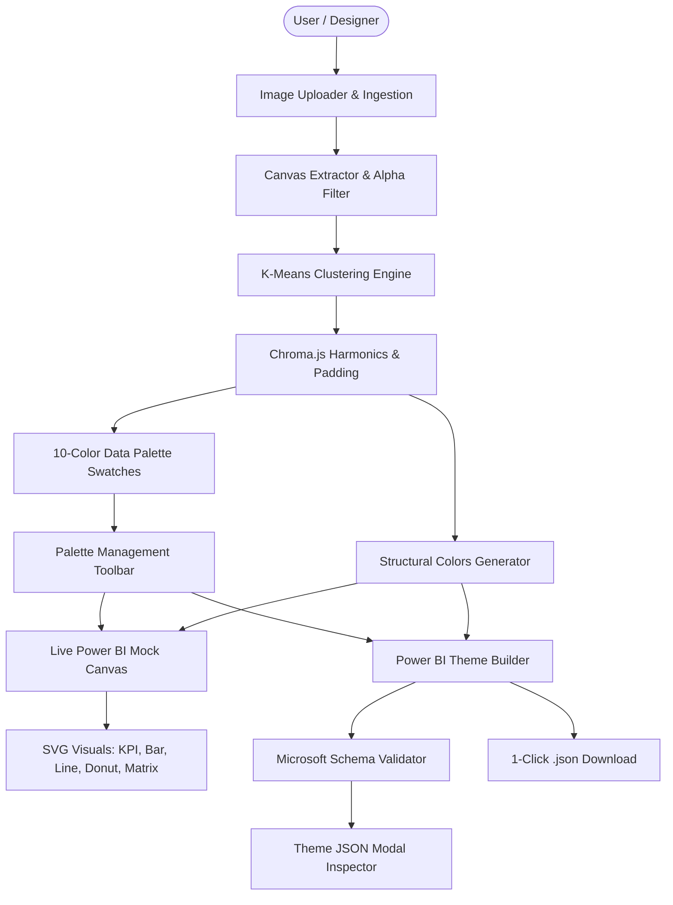

# Architecture: PowerLab

## Component Architecture

### Core Layer (`src/core/`)
- `canvasExtractor.ts`: Downsamples input images to <150px and filters non-opaque pixels (`alpha >= 128`).
- `kmeans.ts`: In-browser K-Means clustering algorithm computing up to 10 cluster centroids.
- `colorHarmonics.ts`: Delta E deduplication, Chroma.js monochromatic/analogous padding to 10 colors, WCAG contrast calculation, and structural color derivation.
- `powerBiTheme.ts`: Microsoft Power BI Theme JSON builder compliant with `reportThemeSchema-latest.json`, validator, and serializer.
- `colorEngine.ts`: Unified asynchronous pipeline orchestrating pixel extraction, clustering, harmonics, and theme compilation.

### UI & Visuals Layer (`src/components/`)
- `ImageUploader.tsx`: Drag-and-drop, file dialog, global clipboard paste (`Ctrl+V`), and sample preset ingestion.
- `PaletteStrip.tsx` & `ColorSwatchCard.tsx`: Sequence badges, uppercase hex inputs, native pickers, lock/unlock, reorder, reverse, shuffle, and WCAG contrast badges.
- `ThemeControls.tsx`: Theme name, Light/Dark canvas background toggle, typography selector, container borders & drop shadows.
- `ReportCanvas.tsx`: Page ribbon, filter breadcrumb, Responsive Grid vs 16:9 Desktop View.
- `visuals/`: Pure SVG visuals (KpiCardRow, ClusteredBarChart, LineTrendChart, DonutChart, StyledMatrixTable).
- `JsonThemeModal.tsx` & `SchemaValidationCard.tsx`: Syntax-highlighted code viewer and Microsoft schema validation checklist.
- `SocialIcons.tsx`: High-clarity vector icons for LinkedIn, Facebook, YouTube, and GitHub.
